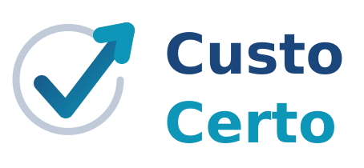

<div align="center">



### Custo Certo — aplicação desktop

*Sistema de gestão de insumos, custos e margem de uma cafeteria, em Java com JavaFX e MySQL.*

<br/>

[](https://openjdk.org/)
[](https://openjfx.io/)
[](https://www.mysql.com/)
[](https://maven.apache.org/)

</div>

---

## Este repositório é o app desktop

O Custo Certo é o Projeto Integrador do curso de Análise e Desenvolvimento de
Sistemas da **FATEC Indaiatuba**, e hoje são **dois projetos independentes**:

| Projeto | Repositório | O que é |
|---|---|---|
| **App desktop** | este aqui | interface Java/JavaFX, acesso ao MySQL por JDBC |
| **Painel web + firmware** | [`Project_Custo_Certo`](https://github.com/Custo-Certo/Project_Custo_Certo) | servidor Node/Express, painel no navegador e o firmware do ESP32 |

Eles **não dependem um do outro para rodar**. O que compartilham são duas coisas
externas a ambos:

- **o banco `custo_certo`**, no MySQL — as duas interfaces leem e escrevem as
  mesmas tabelas, então o que um registra o outro enxerga;
- **a balança**, que é um dispositivo de rede com API própria: cada projeto
  pergunta o peso diretamente a ela.

```
        ┌──────────────────────────┐
        │  Balança ESP32 + HX711   │   GET /peso   POST /tara
        └──────┬───────────┬───────┘
               │           │
     ┌─────────┘           └──────────┐
┌────┴─────────┐            ┌─────────┴────────┐
│ Desktop Java │            │ Painel web (Node)│
│ (este repo)  │            │ (outro repo)     │
└────┬─────────┘            └─────────┬────────┘
     └──────────┐          ┌──────────┘
            ┌───┴──────────┴───┐
            │  MySQL           │
            │  custo_certo     │
            └──────────────────┘
```

Abrir o app desktop **não exige** o servidor Node ligado. Só a balança e o MySQL.

---

## Como rodar

Detalhes completos — instalação do MySQL, contas de teste, solução de problemas —
estão em **[`desktop/README.md`](desktop/README.md)** e em
**[`docs/como-abrir-no-eclipse.md`](docs/como-abrir-no-eclipse.md)**.

O caminho curto, nesta máquina:

```bash
# 1. ligar o banco (deixe a janela aberta)
C:/Users/gabic/MySQL/iniciar-mysql.bat

# 2. abrir o sistema
cd desktop
mvnw.cmd javafx:run      # Windows
./mvnw javafx:run        # Git Bash / Linux / macOS
```

Ou, mais simples, duplo clique em `desktop/abrir-sistema.bat`, que faz as duas
coisas.

Contas de teste:

| E-mail | Senha | Perfil |
|---|---|---|
| `admin@custocerto.com.br` | `admin123` | Administrador |
| `denilson@letscoffee.com.br` | `gestor123` | Gestor |
| `marina@letscoffee.com.br` | `operador123` | Operador |

---

## O que o sistema faz

- **Autenticação e perfis** — login com senha protegida por PBKDF2, trilha de
  auditoria em `log_acesso`, e menu montado pelas permissões do perfil.
- **Contas de acesso** — cadastro, edição, redefinição de senha e inativação,
  disponível apenas ao administrador.
- **Estoque** — cadastro de insumos, compras, retiradas, alertas de nível baixo e
  de validade.
- **Balança** — leitura de peso em tempo real, tara e baixa automática no estoque.
- **Indicadores** — valor imobilizado, giro, cobertura, curva ABC, custo consumido
  e margem por produto.
- **Evolução de preços** — cada compra registra o preço pago, o que mostra a
  variação do custo de aquisição ao longo do tempo.

---

## Documentação

| Documento | Para quê |
|---|---|
| [Como abrir no Eclipse](docs/como-abrir-no-eclipse.md) | passo a passo para clonar, importar e rodar |
| [Modelo de dados](docs/modelo-de-dados.md) | o DER, o dicionário das tabelas e as restrições — entrega de Banco de Dados |
| [Arquitetura do sistema](docs/arquitetura.md) | as camadas, a orientação a objetos e o acesso pela rede — entrega de POO |
| [Decisões da migração](docs/decisoes-da-migracao.html) | as 8 decisões do semestre, com o que já foi fechado |
| [README do app](desktop/README.md) | instalação detalhada e roteiro de apresentação |

---

## Equipe

Projeto desenvolvido por estudantes da **FATEC Indaiatuba**:

<div align="center">

| Integrantes |
|:---|
| Gabriel Marchezoni |
| Gustavo Kauhan |
| Lucas Strinta |
| Vinicius Sterza |
| Warley Alves |

</div>

---

<div align="center">
<sub>FATEC Indaiatuba · Análise e Desenvolvimento de Sistemas · Projeto Integrador</sub>
</div>
