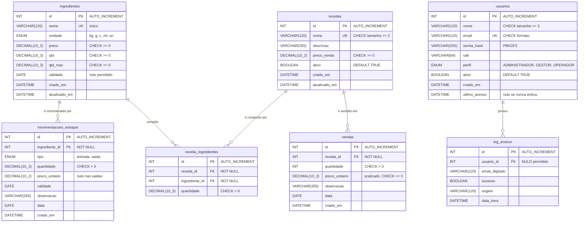

# Modelo de dados — Custo Certo

Documento de entrega da matéria de **Banco de Dados** (Prof. Marlon).

Reúne o diagrama entidade-relacionamento derivado do cenário, o dicionário das
sete tabelas, as restrições declaradas em cada uma e a conferência feita no banco
em execução.

Os scripts que criam este modelo são:

| Script | Cria |
|---|---|
| [`01_schema_usuarios.sql`](../desktop/src/main/resources/sql/01_schema_usuarios.sql) | `usuarios`, `log_acesso` |
| [`02_schema_insumos.sql`](../desktop/src/main/resources/sql/02_schema_insumos.sql) | `ingredientes`, `movimentacoes_estoque` |
| [`03_schema_receitas_vendas.sql`](../desktop/src/main/resources/sql/03_schema_receitas_vendas.sql) | `receitas`, `receita_ingredientes`, `vendas` |

Execute nesta ordem: o segundo referencia o primeiro, e o terceiro referencia o
segundo. SGBD: **MySQL 8.4**, todas as tabelas em `InnoDB` com `utf8mb4`.

---

## 1. O cenário

O Custo Certo atende uma cafeteria que não consegue controlar quanto insumo
consome nem calcular com precisão o **CMV — Custo de Mercadoria Vendida**.

Lendo o cenário, sete fatos precisam ficar guardados:

1. **A cafeteria compra insumos.** Café, leite, açúcar, farinha, copos. Cada um
   tem unidade de medida própria, preço, quantidade em estoque e, quase sempre,
   validade.
2. **O estoque se move.** Toda compra soma; todo consumo — pesado na balança —
   subtrai. Cada compra guarda **o preço pago naquele dia**, senão não há como
   mostrar a evolução do custo.
3. **A cafeteria vende produtos**, não insumos. O cliente pede um cappuccino, e é
   o preço do cappuccino que entra no caixa.
4. **Cada produto consome insumos em quantidades definidas.** É a ficha técnica:
   18 gramas de café, 120 ml de leite, meio grama de canela. Sem ela, o custo de
   um produto é palpite.
5. **É preciso saber o que foi vendido, quando e por quanto**, porque o preço
   praticado nem sempre é o de tabela — promoção, cortesia, reajuste.
6. **Nem todo mundo pode fazer tudo.** Barista registra pesagens; gestor
   acompanha indicadores; administrador cuida das contas.
7. **É preciso saber quem entrou**, inclusive as tentativas com e-mail que não
   existe.

Desses sete fatos saem as sete entidades do modelo.

---

## 2. Diagrama entidade-relacionamento



### Os relacionamentos, e por que são assim

**`receitas` N:M `ingredientes`**, resolvido por `receita_ingredientes` — é o
único relacionamento muitos-para-muitos do modelo. Um produto leva vários
insumos, e o mesmo insumo entra em vários produtos: o café está no expresso, no
cappuccino, no latte e no mocha. A tabela associativa carrega o atributo do
relacionamento, que é a **quantidade** de cada insumo em uma unidade do produto.

**`receitas` 1:N `vendas`** — um produto é vendido muitas vezes. A chave
estrangeira usa `RESTRICT` ao excluir: apagar um produto que já foi vendido
deixaria o faturamento daqueles dias sem explicação.

**`ingredientes` 1:N `movimentacoes_estoque`** — apaga em cascata, porque uma
movimentação sem insumo não significa nada.

**`usuarios` 1:N `log_acesso`** — aqui a chave estrangeira **aceita nulo de
propósito**, e é o detalhe do modelo que mais rende pergunta: quando alguém digita
um e-mail que não está cadastrado, não existe usuário a referenciar, mas a
tentativa precisa ficar registrada — é justamente esse o caso interessante para
auditoria.

### Duas ligações que o modelo deliberadamente NÃO faz

**Vender não dá baixa no estoque.** Não existe gatilho nem chave ligando `vendas`
a `movimentacoes_estoque`. A baixa dos insumos vem da balança, por um caminho
independente. É isso que permite ao sistema comparar depois quanto as vendas
*pediam* — pela ficha técnica — com quanto de fato *saiu*. Se a venda abatesse o
estoque automaticamente, os dois números seriam iguais por construção, e a
comparação não diria nada.

**O custo do produto não é uma coluna.** Ele é somado a cada consulta, cruzando
`receita_ingredientes` com o preço atual em `ingredientes`. Guardar o custo
significaria recalcular o cardápio inteiro a cada reajuste de fornecedor, e
conviver com números velhos até alguém lembrar de fazê-lo.

---

## 3. Dicionário de dados

### `ingredientes` — o estoque ativo

`qtd` é o saldo atual; `qtd_max` é a capacidade de referência, que corresponde a
100% da barra de nível exibida nas interfaces.

| Coluna | Tipo | Nulo | Observação |
|---|---|---|---|
| `id` | `INT AUTO_INCREMENT` | não | chave primária |
| `nome` | `VARCHAR(120)` | não | único no sistema |
| `unidade` | `ENUM('kg','g','L','ml','un')` | não | domínio fechado |
| `preco` | `DECIMAL(10,2)` | não | preço por unidade |
| `qtd` | `DECIMAL(10,3)` | não | saldo atual |
| `qtd_max` | `DECIMAL(10,3)` | não | capacidade de referência |
| `validade` | `DATE` | **sim** | há insumos sem validade, como copos |
| `criado_em` / `atualizado_em` | `DATETIME` | não | preenchidos pelo banco |

### `movimentacoes_estoque` — o histórico do estoque

| Coluna | Tipo | Nulo | Observação |
|---|---|---|---|
| `id` | `INT AUTO_INCREMENT` | não | chave primária |
| `ingrediente_id` | `INT` | não | FK → `ingredientes(id)` |
| `tipo` | `ENUM('entrada','saida')` | não | compra ou consumo |
| `quantidade` | `DECIMAL(10,3)` | não | sempre positiva |
| `preco_unitario` | `DECIMAL(10,2)` | **sim** | nulo nas saídas: consumo não tem preço de compra |
| `validade` | `DATE` | sim | validade do lote comprado |
| `observacao` | `VARCHAR(255)` | sim | texto livre |
| `data` | `DATE` | não | `DEFAULT (CURRENT_DATE)` |

> Guardar o `preco_unitario` **em cada entrada** é o que permite o gráfico de
> evolução de preços. O mesmo café comprado em julho a R$ 49,90 e em agosto a
> R$ 52,90 rende duas linhas — sem isso, a alta de 6% seria invisível.

### `receitas` — o que a cafeteria vende

| Coluna | Tipo | Nulo | Observação |
|---|---|---|---|
| `id` | `INT AUTO_INCREMENT` | não | chave primária |
| `nome` | `VARCHAR(120)` | não | único; ao menos 2 caracteres |
| `descricao` | `VARCHAR(255)` | sim | texto de apoio |
| `preco_venda` | `DECIMAL(10,2)` | não | preço **de tabela** |
| `ativo` | `BOOLEAN` | não | `DEFAULT TRUE`; produto fora do cardápio não some |
| `criado_em` / `atualizado_em` | `DATETIME` | não | preenchidos pelo banco |

### `receita_ingredientes` — a ficha técnica

| Coluna | Tipo | Nulo | Observação |
|---|---|---|---|
| `id` | `INT AUTO_INCREMENT` | não | chave primária |
| `receita_id` | `INT` | não | FK → `receitas(id)`, `ON DELETE CASCADE` |
| `ingrediente_id` | `INT` | não | FK → `ingredientes(id)`, `ON DELETE RESTRICT` |
| `quantidade` | `DECIMAL(10,3)` | não | na unidade do **próprio insumo** |

> A quantidade está sempre na unidade do insumo. Café cadastrado em kg, com 18
> gramas por dose, aparece como `0.018`.
>
> O `RESTRICT` do `ingrediente_id` contrasta de propósito com o `CASCADE` das
> movimentações: excluir um insumo em silêncio deixaria metade do cardápio com a
> ficha técnica furada.

### `vendas` — o faturamento

| Coluna | Tipo | Nulo | Observação |
|---|---|---|---|
| `id` | `INT AUTO_INCREMENT` | não | chave primária |
| `receita_id` | `INT` | não | FK → `receitas(id)`, `ON DELETE RESTRICT` |
| `quantidade` | `INT` | não | sempre positiva |
| `preco_unitario` | `DECIMAL(10,2)` | não | o preço **praticado** naquela venda |
| `observacao` | `VARCHAR(255)` | sim | texto livre |
| `data` | `DATE` | não | `DEFAULT (CURRENT_DATE)` |

> `preco_unitario` não aponta para `receitas.preco_venda`, e essa é a decisão de
> modelagem mais importante desta tabela: reajustar o cardápio hoje não pode
> reescrever o faturamento do mês passado. É a mesma razão pela qual as compras
> guardam o preço pago.

### `usuarios` — as contas de acesso

| Coluna | Tipo | Nulo | Observação |
|---|---|---|---|
| `id` | `INT AUTO_INCREMENT` | não | chave primária |
| `nome` | `VARCHAR(120)` | não | ao menos 3 caracteres |
| `email` | `VARCHAR(120)` | não | login do sistema, único |
| `senha_hash` | `VARCHAR(255)` | não | PBKDF2-HMAC-SHA256, 210.000 iterações |
| `salt` | `VARCHAR(64)` | não | aleatório, um por conta |
| `perfil` | `ENUM(...)` | não | `DEFAULT 'OPERADOR'` |
| `ativo` | `BOOLEAN` | não | `DEFAULT TRUE` |
| `ultimo_acesso` | `DATETIME` | **sim** | nulo enquanto a pessoa nunca entrou |

> **A senha nunca é gravada legível.** Cada linha guarda um salt aleatório e o
> hash da senha somada a ele. Duas pessoas com a mesma senha têm hashes
> diferentes.

### `log_acesso` — a trilha de auditoria

| Coluna | Tipo | Nulo | Observação |
|---|---|---|---|
| `id` | `INT AUTO_INCREMENT` | não | chave primária |
| `usuario_id` | `INT` | **sim** | FK → `usuarios(id)`; nulo quando o e-mail não existe |
| `email_digitado` | `VARCHAR(120)` | não | o que foi digitado, mesmo sem conta |
| `sucesso` | `BOOLEAN` | não | tentativa aceita ou recusada |
| `origem` | `VARCHAR(120)` | sim | nome e IP da máquina de origem |
| `data_hora` | `DATETIME` | não | `DEFAULT CURRENT_TIMESTAMP` |

---

## 4. Restrições declaradas

Consulta feita no banco em execução, em 31/08/2026. São **27 restrições**:

```sql
SELECT TABLE_NAME AS tabela, CONSTRAINT_NAME AS restricao, CONSTRAINT_TYPE AS tipo
  FROM information_schema.TABLE_CONSTRAINTS
 WHERE CONSTRAINT_SCHEMA = 'custo_certo'
 ORDER BY TABLE_NAME, CONSTRAINT_TYPE, CONSTRAINT_NAME;
```

| tabela | restrição | tipo |
|---|---|---|
| `ingredientes` | `ck_ingredientes_preco` | CHECK |
| `ingredientes` | `ck_ingredientes_qtd` | CHECK |
| `ingredientes` | `ck_ingredientes_qtd_max` | CHECK |
| `ingredientes` | `PRIMARY` | PRIMARY KEY |
| `ingredientes` | `uk_ingredientes_nome` | UNIQUE |
| `log_acesso` | `fk_log_acesso_usuario` | FOREIGN KEY |
| `log_acesso` | `PRIMARY` | PRIMARY KEY |
| `movimentacoes_estoque` | `ck_mov_quantidade` | CHECK |
| `movimentacoes_estoque` | `fk_mov_ingrediente` | FOREIGN KEY |
| `movimentacoes_estoque` | `PRIMARY` | PRIMARY KEY |
| `receita_ingredientes` | `ck_ri_quantidade` | CHECK |
| `receita_ingredientes` | `fk_ri_ingrediente` | FOREIGN KEY |
| `receita_ingredientes` | `fk_ri_receita` | FOREIGN KEY |
| `receita_ingredientes` | `PRIMARY` | PRIMARY KEY |
| `receita_ingredientes` | `uk_ri_receita_ingrediente` | UNIQUE |
| `receitas` | `ck_receitas_nome` | CHECK |
| `receitas` | `ck_receitas_preco` | CHECK |
| `receitas` | `PRIMARY` | PRIMARY KEY |
| `receitas` | `uk_receitas_nome` | UNIQUE |
| `usuarios` | `ck_usuarios_email` | CHECK |
| `usuarios` | `ck_usuarios_nome` | CHECK |
| `usuarios` | `PRIMARY` | PRIMARY KEY |
| `usuarios` | `uk_usuarios_email` | UNIQUE |
| `vendas` | `ck_vendas_preco` | CHECK |
| `vendas` | `ck_vendas_quantidade` | CHECK |
| `vendas` | `fk_vendas_receita` | FOREIGN KEY |
| `vendas` | `PRIMARY` | PRIMARY KEY |

### Comportamento referencial

Lido de `information_schema.REFERENTIAL_CONSTRAINTS`:

| Chave estrangeira | ON DELETE | ON UPDATE | Motivo |
|---|---|---|---|
| `log_acesso.usuario_id` | `SET NULL` | `CASCADE` | excluir uma conta não pode apagar a auditoria dela |
| `movimentacoes_estoque.ingrediente_id` | `CASCADE` | `CASCADE` | movimentação sem insumo não significa nada |
| `receita_ingredientes.receita_id` | `CASCADE` | `CASCADE` | ficha sem produto não significa nada |
| `receita_ingredientes.ingrediente_id` | `RESTRICT` | `CASCADE` | não deixa furar a ficha de um produto |
| `vendas.receita_id` | `RESTRICT` | `CASCADE` | não deixa o faturamento ficar órfão |

As três regras de exclusão diferentes não são inconsistência: cada uma responde
o que acontece com o **filho** quando o pai some, e a resposta muda conforme o
filho tenha ou não valor sozinho.

### Restrições que não estão no banco

Algumas regras vivem na camada de serviço da aplicação, e não no MySQL, porque
dependem de **quem está usando o sistema** ou do **estado de outras linhas** —
coisas que uma restrição declarativa não alcança:

- ninguém inativa a própria conta, nem rebaixa o próprio perfil de administrador;
- o último administrador ativo não pode ser inativado nem rebaixado;
- um produto que já teve vendas não pode ser excluído (o banco recusaria com a
  chave estrangeira, mas o serviço consulta antes para explicar o motivo em vez
  de mostrar erro técnico).

Estão em `UsuarioService` e `FichaTecnicaService`, descritas em
[arquitetura.md](arquitetura.md).

---

## 5. Carga inicial

O requisito pede no mínimo 5 linhas por tabela via `INSERT`. Contagem feita no
banco em execução:

| tabela | linhas | mínimo exigido |
|---|---|---|
| `usuarios` | 5 | 5 ✔ |
| `log_acesso` | 27 | 5 ✔ |
| `ingredientes` | 8 | 5 ✔ |
| `movimentacoes_estoque` | 10 | 5 ✔ |
| `receitas` | 6 | 5 ✔ |
| `receita_ingredientes` | 22 | 5 ✔ |
| `vendas` | 12 | 5 ✔ |

`log_acesso` passou de 5 porque cresce sozinha: cada login deixa o seu registro.

Todos os `INSERT` usam `INSERT IGNORE` com `id` explícito, então os scripts podem
ser executados mais de uma vez sem duplicar nada.

Algumas linhas existem para demonstrar comportamentos específicos:

| Linha | Existe para mostrar |
|---|---|
| `ingredientes` id 2 — Leite Integral | validade já vencida → alerta de vencimento |
| `ingredientes` id 3 — Açúcar Cristal | 0,8 de 5,0 = 16% → alerta de nível baixo |
| `ingredientes` id 8 — Copo Descartável | validade nula → coluna que aceita nulo |
| `movimentacoes` ids 1 e 6 — mesmo café | R$ 49,90 em julho, R$ 52,90 em agosto → evolução de preços |
| `usuarios` — conta da Camila | `ativo = FALSE` → recusa de conta desativada |
| `vendas` de julho e agosto | produzem variância realista contra as saídas já registradas |

As quantidades vendidas não foram escolhidas ao acaso. Elas produzem, contra as
saídas de estoque já existentes, uma comparação com números defensáveis:

| Insumo | Período | Teórico | Real | Variância |
|---|---|---|---|---|
| Café em Grãos | julho | 1,620 kg | 1,800 kg | +11,1% |
| Leite Integral | julho | 2,130 L | 2,500 L | +17,4% |
| Açúcar Cristal | agosto | 3,800 kg | 4,200 kg | +10,5% |
| Chocolate em Pó | agosto | 1,499 kg | 1,500 kg | +0,1% |

Os três primeiros mostram consumo acima da ficha, que é o caso que o indicador
existe para pegar; o quarto mostra uma operação sob controle.

---

## 6. Quem lê estas tabelas

As sete tabelas atendem **dois projetos independentes**, em repositórios
separados, que não dependem um do outro para rodar:

| Tabela | App desktop (Java) | Painel web (Node) |
|---|---|---|
| `usuarios` | login e tela de contas | — |
| `log_acesso` | auditoria do login | — |
| `ingredientes` | tela de Estoque | rotas `/ingredientes` |
| `movimentacoes_estoque` | compras, retiradas, gráficos | rotas de compra e retirada |
| `receitas` | tela de Ficha Técnica | rotas `/receitas` |
| `receita_ingredientes` | ficha técnica e cálculo de custo | idem |
| `vendas` | tela de Vendas | rotas `/vendas` |

O banco é o que os dois compartilham. Foi conferido que os indicadores calculados
de cada lado dão exatamente o mesmo número para o mesmo período — faturamento
R$ 1.596,00, custo pela ficha R$ 237,43, margem bruta R$ 1.358,57 e CMV de 14,9%
nos últimos 90 dias.

As contas do MySQL seguem o princípio do menor privilégio:

| Conta | Alcance | Privilégios |
|---|---|---|
| `root` | só de `localhost` | tudo — usada apenas para rodar os scripts |
| `custocerto` | de qualquer host | `SELECT, INSERT, UPDATE, DELETE` apenas em `custo_certo` |

A aplicação usa **somente** a conta `custocerto`. Ela não tem privilégio de
`CREATE` nem `DROP`: se um dia alguém conseguisse injetar SQL por uma tela, o
estrago possível não incluiria derrubar o schema.

---

## 7. O que este modelo ainda não cobre

Registro honesto do que ficou de fora, e por quê:

- **Lotes de validade não são uma entidade.** Hoje a validade é uma coluna em
  `ingredientes` e outra em `movimentacoes_estoque`. Isso sustenta o alerta de
  vencimento, mas não sustenta bem a baixa por FIFO prometida no README: para
  dar baixa no lote mais antigo, seria preciso saber o saldo restante *de cada
  lote*, e não apenas a validade mais próxima.
- **O custo histórico não é reconstruível.** O custo de um produto é sempre
  calculado com o preço que o insumo tem *hoje*. Saber quanto um cappuccino
  custava em julho exigiria guardar o preço de cada insumo em cada data.
- **Não há dado de mão de obra**, então o custo primário — CMV mais folha, que o
  setor acompanha junto — não pode ser calculado.

As três são candidatas naturais ao próximo ciclo. A primeira é a mais próxima:
uma entidade de lote resolveria FIFO e melhoraria a apuração de perdas.
