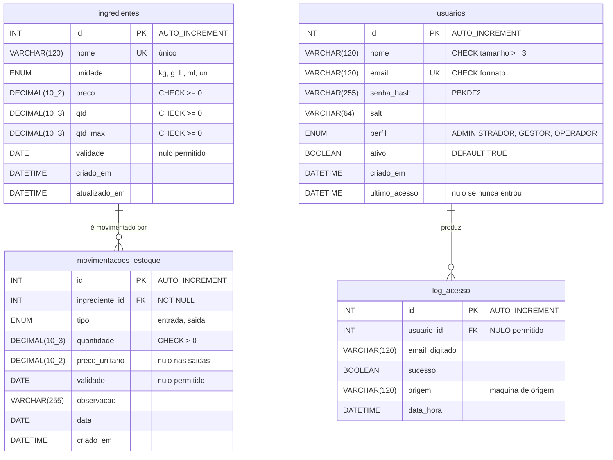

# Modelo de dados — Custo Certo

Documento de entrega da matéria de **Banco de Dados** (Prof. Marlon).

Reúne o diagrama entidade-relacionamento derivado do cenário, o dicionário das
quatro tabelas, as restrições declaradas em cada uma e a conferência feita no
banco em execução.

Os scripts que criam este modelo são:

| Script | Cria |
|---|---|
| [`desktop/src/main/resources/sql/01_schema_usuarios.sql`](../desktop/src/main/resources/sql/01_schema_usuarios.sql) | `usuarios`, `log_acesso` |
| [`desktop/src/main/resources/sql/02_schema_insumos.sql`](../desktop/src/main/resources/sql/02_schema_insumos.sql) | `ingredientes`, `movimentacoes_estoque` |

SGBD: **MySQL 8.4**, todas as tabelas em `InnoDB` com `utf8mb4`.

---

## 1. O cenário

O Custo Certo atende uma cafeteria que não consegue controlar quanto insumo
consome nem calcular com precisão o **CMV — Custo de Mercadoria Vendida**.

Lendo o cenário, quatro fatos precisam ficar guardados:

1. **A cafeteria compra insumos.** Café, leite, açúcar, farinha, copos. Cada um
   tem uma unidade de medida própria, um preço, uma quantidade em estoque e,
   quase sempre, uma validade.
2. **O estoque se move.** Toda compra soma; todo consumo — pesado na balança
   inteligente — subtrai. Cada compra tem de guardar **o preço pago naquele dia**,
   senão não há como mostrar a evolução do custo nem apurar o CMV.
3. **Nem todo mundo pode fazer tudo.** O barista registra pesagens; o gestor
   acompanha indicadores; o administrador cuida das contas. São três perfis com
   permissões diferentes.
4. **É preciso saber quem entrou.** Tentativas de acesso, aceitas e recusadas,
   precisam ficar registradas — inclusive as que usaram um e-mail que não existe.

Desses quatro fatos saem as quatro entidades do modelo.

---

## 2. Diagrama entidade-relacionamento



### Os dois relacionamentos, e por que são assim

**`ingredientes` 1:N `movimentacoes_estoque`** — um insumo é comprado e consumido
muitas vezes; cada movimentação pertence a exatamente um insumo. A chave
estrangeira é `NOT NULL` e apaga em cascata: uma movimentação sem insumo não
significa nada, então excluir o insumo leva o histórico junto.

**`usuarios` 1:N `log_acesso`** — uma conta produz muitas tentativas de login.
Aqui a chave estrangeira **aceita nulo de propósito**, e é o detalhe do modelo que
mais rende pergunta: quando alguém digita um e-mail que não está cadastrado, não
existe usuário a referenciar, mas a tentativa precisa ficar registrada — é
justamente esse o caso interessante para auditoria. O `ON DELETE SET NULL` segue a
mesma ideia: excluir uma conta não apaga o histórico dela, apenas desliga o
vínculo.

---

## 3. Dicionário de dados

### `ingredientes` — o estoque ativo

Uma linha por insumo. `qtd` é o saldo atual; `qtd_max` é a capacidade de
referência, que corresponde a 100% da barra de nível exibida nas duas interfaces.

| Coluna | Tipo | Nulo | Observação |
|---|---|---|---|
| `id` | `INT AUTO_INCREMENT` | não | chave primária |
| `nome` | `VARCHAR(120)` | não | único no sistema |
| `unidade` | `ENUM('kg','g','L','ml','un')` | não | domínio fechado |
| `preco` | `DECIMAL(10,2)` | não | preço por unidade, padrão `0.00` |
| `qtd` | `DECIMAL(10,3)` | não | saldo atual, padrão `0.000` |
| `qtd_max` | `DECIMAL(10,3)` | não | capacidade de referência |
| `validade` | `DATE` | **sim** | há insumos sem validade, como copos |
| `criado_em` | `DATETIME` | não | `DEFAULT CURRENT_TIMESTAMP` |
| `atualizado_em` | `DATETIME` | não | `ON UPDATE CURRENT_TIMESTAMP` |

### `movimentacoes_estoque` — o histórico

| Coluna | Tipo | Nulo | Observação |
|---|---|---|---|
| `id` | `INT AUTO_INCREMENT` | não | chave primária |
| `ingrediente_id` | `INT` | não | FK → `ingredientes(id)` |
| `tipo` | `ENUM('entrada','saida')` | não | compra ou consumo |
| `quantidade` | `DECIMAL(10,3)` | não | sempre positiva |
| `preco_unitario` | `DECIMAL(10,2)` | **sim** | nulo nas saídas: consumo não tem preço de compra |
| `validade` | `DATE` | sim | validade do lote comprado |
| `observacao` | `VARCHAR(255)` | sim | texto livre |
| `data` | `DATE` | não | `DEFAULT (CURRENT_DATE)` |
| `criado_em` | `DATETIME` | não | `DEFAULT CURRENT_TIMESTAMP` |

> Guardar o `preco_unitario` **em cada entrada**, e não apenas o preço atual em
> `ingredientes`, é o que permite o gráfico de evolução de preços. O mesmo café
> comprado em julho a R$ 49,90 e em agosto a R$ 52,90 rende duas linhas com
> preços diferentes — sem isso, a alta de 6% seria invisível.

### `usuarios` — as contas de acesso

| Coluna | Tipo | Nulo | Observação |
|---|---|---|---|
| `id` | `INT AUTO_INCREMENT` | não | chave primária |
| `nome` | `VARCHAR(120)` | não | ao menos 3 caracteres |
| `email` | `VARCHAR(120)` | não | login do sistema, único |
| `senha_hash` | `VARCHAR(255)` | não | PBKDF2-HMAC-SHA256, 210.000 iterações |
| `salt` | `VARCHAR(64)` | não | aleatório, um por conta |
| `perfil` | `ENUM(...)` | não | `DEFAULT 'OPERADOR'` |
| `ativo` | `BOOLEAN` | não | `DEFAULT TRUE` |
| `criado_em` | `DATETIME` | não | `DEFAULT CURRENT_TIMESTAMP` |
| `ultimo_acesso` | `DATETIME` | **sim** | nulo enquanto a pessoa nunca entrou |

> **A senha nunca é gravada legível.** Cada linha guarda um salt aleatório e o
> hash da senha somada a ele. Duas pessoas com a mesma senha têm hashes
> diferentes, e o conteúdo da coluna não permite voltar à senha original.

### `log_acesso` — a trilha de auditoria

| Coluna | Tipo | Nulo | Observação |
|---|---|---|---|
| `id` | `INT AUTO_INCREMENT` | não | chave primária |
| `usuario_id` | `INT` | **sim** | FK → `usuarios(id)`; nulo quando o e-mail não existe |
| `email_digitado` | `VARCHAR(120)` | não | o que foi digitado, mesmo sem conta |
| `sucesso` | `BOOLEAN` | não | tentativa aceita ou recusada |
| `origem` | `VARCHAR(120)` | sim | nome e IP da máquina de onde partiu |
| `data_hora` | `DATETIME` | não | `DEFAULT CURRENT_TIMESTAMP` |

---

## 4. Restrições declaradas

Consulta feita no banco em execução, em 29/08/2026:

```sql
SELECT TABLE_NAME AS tabela, CONSTRAINT_NAME AS restricao, CONSTRAINT_TYPE AS tipo
  FROM information_schema.TABLE_CONSTRAINTS
 WHERE CONSTRAINT_SCHEMA = 'custo_certo'
 ORDER BY TABLE_NAME, CONSTRAINT_TYPE, CONSTRAINT_NAME;
```

| tabela | restrição | tipo |
|---|---|---|
| `ingredientes` | `ck_ingredientes_preco` | CHECK |
| `ingredientes` | `ck_ingredientes_qtd` | CHECK |
| `ingredientes` | `ck_ingredientes_qtd_max` | CHECK |
| `ingredientes` | `PRIMARY` | PRIMARY KEY |
| `ingredientes` | `uk_ingredientes_nome` | UNIQUE |
| `log_acesso` | `fk_log_acesso_usuario` | FOREIGN KEY |
| `log_acesso` | `PRIMARY` | PRIMARY KEY |
| `movimentacoes_estoque` | `ck_mov_quantidade` | CHECK |
| `movimentacoes_estoque` | `fk_mov_ingrediente` | FOREIGN KEY |
| `movimentacoes_estoque` | `PRIMARY` | PRIMARY KEY |
| `usuarios` | `ck_usuarios_email` | CHECK |
| `usuarios` | `ck_usuarios_nome` | CHECK |
| `usuarios` | `PRIMARY` | PRIMARY KEY |
| `usuarios` | `uk_usuarios_email` | UNIQUE |

### Comportamento referencial

| Chave estrangeira | ON DELETE | ON UPDATE | Motivo |
|---|---|---|---|
| `movimentacoes_estoque.ingrediente_id` | `CASCADE` | `CASCADE` | movimentação sem insumo não significa nada |
| `log_acesso.usuario_id` | `SET NULL` | `CASCADE` | excluir uma conta não pode apagar a auditoria dela |

### Restrições que não estão no banco

Três regras vivem na camada de serviço da aplicação Java, e não no MySQL, porque
dependem de **quem está usando o sistema no momento** — algo que o banco não tem
como saber:

- ninguém inativa a própria conta;
- ninguém rebaixa o próprio perfil de administrador;
- o último administrador ativo não pode ser inativado nem rebaixado.

Estão em `UsuarioService`, descritas em [arquitetura.md](arquitetura.md).

---

## 5. Carga inicial

O requisito pede no mínimo 5 linhas por tabela via `INSERT`. Contagem feita no
banco em execução:

```sql
SELECT 'usuarios' AS tabela, COUNT(*) AS linhas FROM usuarios
UNION ALL SELECT 'log_acesso',            COUNT(*) FROM log_acesso
UNION ALL SELECT 'ingredientes',          COUNT(*) FROM ingredientes
UNION ALL SELECT 'movimentacoes_estoque', COUNT(*) FROM movimentacoes_estoque;
```

| tabela | linhas | mínimo exigido |
|---|---|---|
| `usuarios` | 5 | 5 ✔ |
| `log_acesso` | 21 | 5 ✔ |
| `ingredientes` | 8 | 5 ✔ |
| `movimentacoes_estoque` | 10 | 5 ✔ |

`log_acesso` passou de 5 porque cresce sozinha: além das linhas do script, cada
login feito durante os testes deixou o seu registro.

Todos os `INSERT` usam `INSERT IGNORE` com `id` explícito, então os scripts podem
ser executados mais de uma vez sem duplicar nada — foi testado.

Algumas linhas existem para demonstrar comportamentos específicos:

| Linha | Existe para mostrar |
|---|---|
| `ingredientes` id 2 — Leite Integral | validade já vencida → alerta de vencimento |
| `ingredientes` id 3 — Açúcar Cristal | 0,8 de 5,0 = 16% → alerta de nível baixo |
| `ingredientes` id 8 — Copo Descartável | validade nula → coluna que aceita nulo |
| `movimentacoes` ids 1 e 6 — mesmo café | R$ 49,90 em julho, R$ 52,90 em agosto → evolução de preços |
| `usuarios` — conta da Camila | `ativo = FALSE` → recusa de conta desativada no login |

---

## 6. Quem lê estas tabelas

As mesmas quatro tabelas atendem duas interfaces:

| Tabela | App desktop (Java) | Painel web (Node) |
|---|---|---|
| `usuarios` | login e tela de contas | — |
| `log_acesso` | auditoria do login | — |
| `ingredientes` | tela de Estoque | rotas `/ingredientes` |
| `movimentacoes_estoque` | compras, retiradas, gráficos | rotas de compra e retirada |

Até a migração deste semestre o painel web usava um banco SQLite próprio, e as
duas interfaces mostravam números diferentes. Agora ambas apontam para o mesmo
`custo_certo`.

As contas do MySQL seguem o princípio do menor privilégio:

| Conta | Alcance | Privilégios |
|---|---|---|
| `root` | só de `localhost` | tudo — usada apenas para rodar os scripts |
| `custocerto` | de qualquer host | `SELECT, INSERT, UPDATE, DELETE` apenas em `custo_certo` |

A aplicação usa **somente** a conta `custocerto`. Ela não tem privilégio de
`CREATE` ou `DROP`: se um dia alguém conseguisse injetar SQL por uma rota, o
estrago possível não incluiria derrubar o schema.

---

## 7. O que este modelo ainda não cobre

Registro honesto do que ficou de fora, e por quê:

- **`receitas` e `receita_ingredientes`** existiam no schema SQLite anterior,
  preparadas para uso futuro, e nunca foram usadas por nenhuma tela ou rota. Não
  foram migradas. Sustentar CMV por produto vendido — "quanto custa um
  cappuccino" — depende delas.
- **Lotes de validade** não são uma entidade. Hoje a validade é uma coluna em
  `ingredientes` e outra em `movimentacoes_estoque`, o que não sustenta bem a
  baixa por FIFO prometida no README.

As duas pendências dependem da **decisão D5**, sobre o escopo do DER, ainda em
aberto no grupo — ver [decisoes-da-migracao.html](decisoes-da-migracao.html).
Este documento descreve o **modelo que está no ar hoje**, com as quatro tabelas
que as duas interfaces realmente usam.
